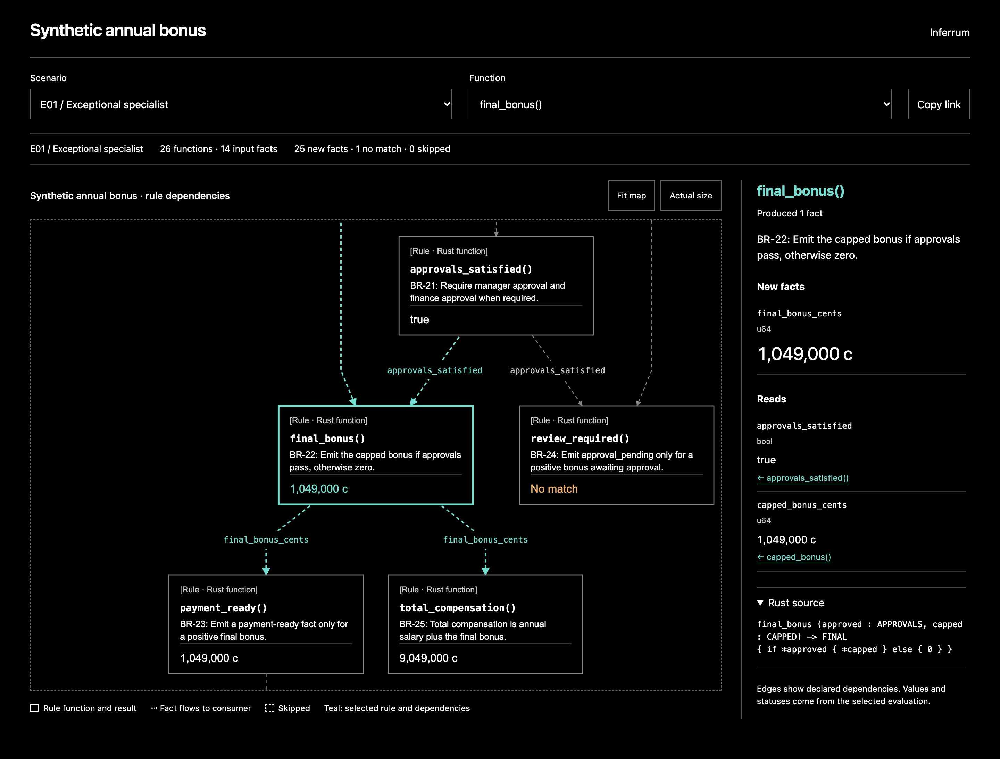

# Inferrum

Inferrum is a Rust crate for business rules arranged as a directed acyclic graph.
Declare typed facts and rules. Inferrum checks their dependencies,
runs them in topological order, and returns only newly derived facts.



The [bonus example](#synthetic-business-rules) with `final_bonus` selected.
[View the full graph](fixtures/bonus/rules.svg).

```rust
use inferrum::{declare_facts, facts, rule, ruleset};

declare_facts! {
    SCORE: u8 = "performance";
    BONUS: u64 = "bonus_cents";
}

let engine = ruleset! {
    inputs [SCORE];
    rules [
        rule! { calculate_bonus(score: SCORE) -> ? BONUS {
            (*score > 50).then_some(100_000)
        }}.description("Scores above 50 receive a bonus."),
    ];
}?;

let input = facts! { SCORE => 75 }?;
let new_facts = engine.run(&input)?;
assert_eq!(new_facts.get(BONUS)?, Some(&100_000));
assert_eq!(new_facts.get(SCORE)?, None);
# Ok::<(), inferrum::Error>(())
```

Requires Rust 1.85 or later. The default build has no dependencies. Add it locally with
`inferrum = { path = "path/to/inferrum", features = ["visualization"] }`.
It is not published to crates.io.

## Author rules with macros

`declare_facts!` creates typed constants with explicit, stable names. Each
declaration accepts visibility and attributes, such as `pub` and doc comments.
`facts!` builds a collection from `KEY => value` entries and returns a `Result`.
Duplicate or empty names return an error. `facts! {}` creates an empty collection.

`rule!` declares dependencies once and binds each input as a shared reference.
Values need no `Clone` implementation. The body is ordinary Rust and can use
`?` or `return Err(...)` to report an evaluation error. The identifier becomes
the rule ID, and the declaration is captured as source for the inspector.

- `-> KEY` emits the body's value as that fact. Rust checks its type.
- `-> ? KEY` expects `Option<T>`. `None` produces no fact.
- `-> [KEY, ...]` expects `Result<Facts, Error>` for multiple or partial outputs.

For example, a rule can declare two outputs and choose which to emit:

```rust
use inferrum::{declare_facts, facts, rule, ruleset};
declare_facts! {
    SCORE: u8 = "score";
    PASSED: bool = "passed";
    AWARD: u64 = "award_cents";
}
let engine = ruleset! {
    inputs [SCORE];
    rules [rule! { assess(score: SCORE) -> [PASSED, AWARD] {
        if *score > 50 {
            facts! { PASSED => true, AWARD => 100_000 }
        } else {
            facts! { PASSED => false }
        }
    }}];
}?;
assert_eq!(engine.run(&facts! { SCORE => 50 }?)?.get(PASSED)?, Some(&false));
# Ok::<(), inferrum::Error>(())
```

`ruleset!` lists initial input keys and rule expressions, then returns a validated
engine. Fact keys in `rule!` and `ruleset!` can be qualified paths, such as
`policy::SCORE`. You can mix macro-authored rules with `Rule::new` and continue
using `Fact`, `Facts`, and `Engine::new` directly.

## Evaluation contract

- Each fact has one name, one Rust type, and one producer. An initial input also
  counts as a producer. Conflicting names, types, dependencies, and cycles fail
  when you construct the engine.
- Each rule runs at most once per evaluation. Independent rules use registration
  order to break ties. Rules can read only their declared inputs.
- A missing input skips the rule. `false` is a present value, so boolean decisions
  can flow through joins. Returning empty facts means the condition did not match.
  Rules may emit any subset of their declared outputs.
- Facts are append-only. Input values cannot be overwritten. A rule error ends
  evaluation without returning partial facts. `evaluate` also returns a trace
  that records produced, unmatched, and skipped rules.
- One evaluation represents one business case. Supply a fresh collection for
  another employee. There is no shared working memory, retraction, fixpoint loop,
  persistence, async runtime, or automatic multi-record join.
- Callbacks are ordinary Rust functions or closures. Keep them pure. The engine
  cannot prevent external I/O, interior mutation, or panics in application code.
  It does not catch panics or roll back callback side effects. Fact values must
  implement `Debug + Send + Sync + 'static` and should not use interior mutation.

## Synthetic business rules

The example expands the employee bonus idea in `eg.inferrum` into 26 declarative
rules, 14 input facts, 26 possible derived facts, and 14 fixed scenarios.
It includes eligibility gates, parallel calculations, joins, budget caps,
approval branches, and an optional payment fact. It never sends payments.
The `.inferrum` file remains a language sketch; this version executes Rust
rule bodies and does not parse that syntax.

```sh
cargo run --example bonus --features visualization
```

The command writes these artifacts under `target/bonus/`. Pass a different
directory as the final argument to change the destination. Existing export files
with the same names are replaced.

| File | Contents |
|---|---|
| `index.html` | Interactive function DAG, scenario picker, and rule inspector |
| `requirements.md` | All 26 business requirements with function signatures |
| `functions.tsv` | The same rule catalog in tab-separated form |
| `inputs.tsv` | Synthetic input facts for every employee |
| `derived-facts.tsv` | Every newly produced fact |
| `scenarios.tsv` | Purposes, expected amounts, actual amounts, and review outcomes |
| `trace.tsv` | Function outcomes for each scenario |
| `rules.dot` | Function dependencies, with facts labeled on edges |
| `facts.dot` | Full graph of input facts, rule functions, and derived facts |

The policy is fictional. Values use integer cents and basis points, with each
multiplication rounded down. The budget is a per-employee allocation. The example
uses checked arithmetic and validates performance scores. See
[the requirements](docs/requirements.md) and
[the functions and fixtures](examples/support/bonus.rs).

Generated examples are included in [fixtures/bonus](fixtures/bonus), including
the [complete business requirements](fixtures/bonus/requirements.md),
[scenario outcomes](fixtures/bonus/scenarios.tsv), and
[rendered function DAG](fixtures/bonus/rules.svg).

## Visualize a ruleset

Enable the `visualization` Cargo feature to get an interactive HTML viewer,
an inspectable graph, and DOT export. This feature uses Serde and `serde_json`
to serialize viewer snapshots. Fact values only need `Debug`, not `Serialize`.

After running the bonus example, open `target/bonus/index.html` in a browser.
Select a scenario or click a function to inspect its requirement, inputs, newly
derived facts, execution status, and Rust source. Input facts link to their
producer functions. Skipped rules and rules that produced no facts have distinct
statuses. Mobile widths use an ordered dependency list with the same inspector.

The HTML file is self-contained and works offline. Scenario selection displays
snapshots evaluated during export. To evaluate new inputs, regenerate the file.
The selected case and function are saved in the URL fragment and restored by
reload, Back, and Forward.

Export your own engine with `Engine::to_html`:

```rust
# #[cfg(feature = "visualization")]
# fn export_html(engine: &inferrum::Engine, inputs: inferrum::Facts) -> Result<String, inferrum::Error> {
use inferrum::visualization::ViewerCase;
let cases = [ViewerCase::new("sample", "Sample inputs", inputs)];
let html = engine.to_html("My ruleset", &cases)?;
# Ok(html)
# }
```

`to_html` executes the callbacks once per case and returns an error if any case
fails. An empty case slice exports the topology without running callbacks.
The export embeds input values, derived values, and traces. Values use Rust's
`Debug` representation. `rule!` captures source automatically. For rules built
with `Rule::new`, attach optional source excerpts with
`Rule::source(include_str!("my_rule.rs"))`; the viewer displays them as text.

You can also inspect and render the graph separately:

```rust
# #[cfg(feature = "visualization")]
# fn export(engine: &inferrum::Engine) -> String {
use inferrum::visualization::GraphView;
let graph = engine.graph(GraphView::Facts);
graph.to_dot()
# }
```

Render the example with [Graphviz](https://graphviz.org/docs/layouts/dot/):

```sh
dot -Tsvg target/bonus/rules.dot -o target/bonus/rules.svg
dot -Tsvg target/bonus/facts.dot -o target/bonus/facts.svg
```

The graph describes all declared dependencies, including branches that may not
produce facts for a particular input. Hexagons are initial inputs, rectangles are
functions, and ellipses are derived facts. `GraphView::Rules` omits input facts
and keeps the function dependencies. Use `engine.rules()` to inspect requirements
and typed signatures without the visualization feature.

The viewer implements option A from the
[approved static design](https://kv2xry4zcwv1.postplan.dev). The original comparison
remains in `design/visualization-options.html`.

## Call from Go

The optional [`inferrum-ffi` crate](ffi/README.md) provides a Rust static library,
a Protobuf contract, and a cgo wrapper for the fictional bonus policy. Your Go
application supplies inputs and receives derived facts inside the same process.
The core crate keeps its dependency-free default build. See the
[Go integration guide](ffi/README.md) for setup, ownership rules, and tests.

## Development

Install [cargo-nextest](https://nexte.st/docs/installation/pre-built-binaries/)
before running the test suite. CI uses prebuilt binaries so installing the runner
does not depend on the crate's minimum Rust version.

```sh
cargo fmt --check
cargo nextest run --locked --no-default-features
cargo nextest run --locked --all-features
cargo test --locked --all-features --doc
cargo bench --locked --all-features --bench engine -- --test
cargo clippy --locked --all-features --all-targets -- -D warnings
```

Nextest runs unit and integration tests. Doctests run separately with Cargo.
The `ci` Nextest profile runs the full suite even if a test fails. You can still
use `cargo test --all-features --lib --tests` without installing Nextest.

Criterion benchmarks measure construction of the 26-rule bonus policy, `run`
and `evaluate` across its 14 scenarios, and HTML export with visualization
enabled. Inputs are prepared before timing. Run benchmarks and compare changes
against a saved baseline with:

```sh
cargo bench --locked --all-features --bench engine -- --save-baseline before
# Make your changes, then compare on the same machine with the same toolchain.
cargo bench --locked --all-features --bench engine -- --baseline before
```

HTML reports and charts are written under `target/criterion/`, starting at
`target/criterion/report/index.html`. CI checks benchmark execution without
enforcing timing thresholds. Criterion 0.7 supports Rust 1.85 and is only a
development dependency. Serde dependencies are optional and enabled by
`visualization`; the core retains its typed errors and sequential rule order.

Regenerate the included synthetic exports and static mocks with:

```sh
cargo run --example bonus --features visualization -- fixtures/bonus
dot -Tsvg fixtures/bonus/rules.dot -o fixtures/bonus/rules.svg
dot -Tsvg fixtures/bonus/facts.dot -o fixtures/bonus/facts.svg
python3 design/build_mocks.py
```

The mock generator requires Python 3 and Graphviz. The interactive viewer does
not require either tool. Its TypeScript source lives in `viewer/viewer.ts`, and
its HTML/CSS template lives in `src/visualization/viewer.html`. The checked-in
JavaScript bundle includes Dagre for graph layout and its license notices.
Building or using the Rust crate does not require Node.

After editing the browser code, rebuild the bundle before regenerating HTML:

```sh
npm ci
npm run build:viewer
cargo run --example bonus --features visualization
npx playwright install chromium webkit
npm run test:ui
```

For a local HTTP preview, run `npm run preview` and open
[the bonus viewer](http://127.0.0.1:4173/#case=E01&rule=final_bonus).
This command generates the example and serves only `target/bonus` on loopback.
It requires Python 3. Opening the exported HTML directly needs no server.

CI runs Nextest, doctests, and benchmark checks on the minimum supported toolchain
and stable Rust, plus Chromium and WebKit checks at 320px, 390px, 844px, and 1440px.
Browser checks cover
populated views, expanded source, long values, overflow, scenario outcomes,
keyboard selection, URL history, and safe text rendering. CI also checks that
the bundled JavaScript matches its TypeScript source.

## License

Copyright 2026 Vít Chrubasík.

Inferrum is licensed under the [Apache License 2.0](LICENSE).
Bundled third-party code retains its own license notices.
